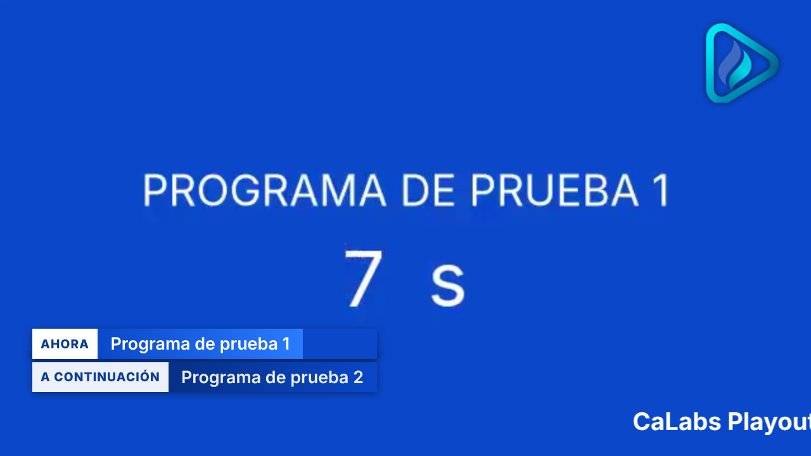
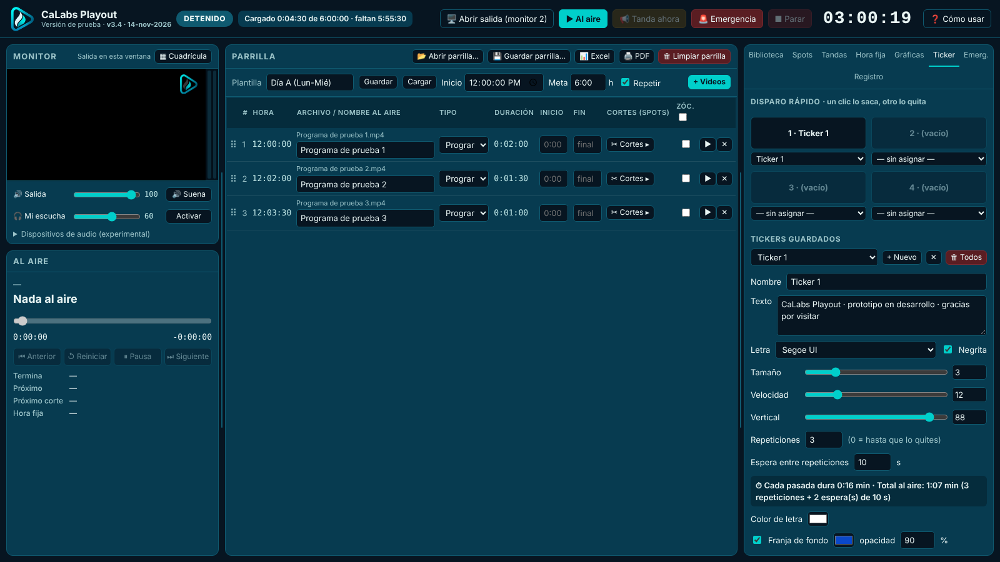

# 📺 CaLabs Playout

**A modern TV playout system that runs in your browser.**
*Un sistema de playout para televisión que funciona en el navegador.*

🚧 `Browser prototype v3.4` · `Native version 2.3 (CasparCG + NDI) · in development` 🚧

---

## 🇬🇧 English

CaLabs Playout is a **TV playout prototype built as a single HTML file**. A modern alternative to old, expensive and unintuitive broadcast software, ideal for people getting started in TV scheduling and media ingest.

> ⚠️ **Language note:** the interface is available in **Spanish and English**. The newer **Inputs** and **Updates** tabs are still Spanish only; their translation is in progress. 🌍

### ✨ What it does today
- 🗓️ Schedule grid with a running counter of loaded hours and a free target length
- ✂️ Ad breaks *inside* a program, using saved spot groups
- 📢 Break blocks and fixed-time events
- 🖥️ Separate output window (and extra outputs) with seamless switching between videos
- 🎨 On-screen graphics: logo bug with effects, clock, lower third and ticker
- 🔊 Level meter plus separate output and monitoring volume
- 🧩 Resizable panels and saved templates

### 🚀 Try it
1. Download or clone this repository.
2. Double-click `Abrir CaLabs Playout.bat` (Windows, uses Chrome or Edge), or open `CaLabs_Playout.html` in Chrome.
3. Load your own MP4 videos from the Library tab.
4. Have MPG, AVI or WMV files? Use `Convertir MPG a MP4.bat` (needs FFmpeg).

### 🧱 Native version 2.3 — CasparCG + NDI (in development)

A rewrite as a **native Windows program** (C# / .NET 10) on top of the **CasparCG 2.5** engine, with **NDI output**. The browser prototype above stays as it is; the new source lives in [`v2/`](v2/).

**✅ What's new in 2.0**
- 🛡️ Built to stay on air: engine, scheduler and control window are **independent programs**. A supervisor restarts whatever freezes or dies (engine, scheduler, window), and the picture keeps playing if the window is closed.
- 🚨 Emergency playlist that takes over by itself if the video stops advancing; going back to the schedule is manual (*now* or *when the emergency clip ends*).
- ✂️ Ad breaks **inside** a program (the program resumes exactly where it left off), "Break now" (*now* / *when the program ends*) and fixed-time breaks, all run by the engine even with the window closed.
- 🎨 Graphics on air (logo bug with effects, clock, lower third, ticker) drawn by the engine, so they go out on the **screen output and NDI**. Rules built in: no graphics on ads or very short clips, logo only on emergency, ticker and lower third take turns.
- 🔀 Optional fade between videos and optional "skip black + silence at the end of a program".
- 🖥️ Full-screen output on any connected monitor, an "emergency exit" hotkey (`Ctrl+Alt+V`) and a tray icon.
- 🔊 Real level meter and volume from the engine, fixed audio output device (with a red warning if it is missing) and a private "listen" output.
- 💾 Everything you save is also written to a file with automatic backups, and restored if the program's memory is deleted.
- 📦 Windows installer with terms & conditions, install-folder choice and start-with-Windows option (see [`v2/Instalador`](v2/Instalador)).

**🆕 What's new in 2.1 – 2.3**
- 🖼️ **2.1:** program icon on the desktop shortcut and the taskbar.
- 📥 **2.2 · Inputs:** a new **Inputs** tab. Pick an **NDI** source or a **YouTube / Facebook** link, prepare it on a separate preview channel and put it **LIVE** with a two-step confirmation. While live there is no automation (no breaks, ads or fixed-time events): if the signal drops, the operator decides. Includes a "Leave live" button and an in-app yt-dlp updater.
- 🔄 **2.3 · Updates:** visible version number, **Check for updates** and **What's new** buttons, an amber notice when a new version exists (asks for confirmation, warns that the air is interrupted), verified download, backup and **automatic rollback** if the new version does not start. Every update is **signed** (ECDSA P-256) and the program rejects anything that fails verification.
- 🧰 Installer with optional Windows tweaks (no sleep, no system sounds, no forced Windows Update restarts, no notifications; all reverted on uninstall) and bundled VC++ and WebView2.

**🔜 What is still missing** — see the roadmap below.

**🛠️ Build it** — you need the [.NET 10 SDK](https://dotnet.microsoft.com/) and the CasparCG 2.5.1 release (download it from its official page; it is **not** included here). NDI output needs [NDI Tools](https://ndi.video/). To make the installer you also need [Inno Setup 6](https://jrsoftware.org/isinfo.php): run `v2/Instalador/construir.ps1 -Motor "<path to CasparCG>"`.

### 🗺️ Roadmap

**✅ Done** *(in the browser prototype and in the native 2.0)*
- [x] ~~🎨 Color themes: Day / Night / Neutral (always built from the CaLabs palette) plus a Custom theme with free colors~~
- [x] ~~🌍 Language switch (Spanish / English)~~
- [x] ~~📊 Classic green-yellow-red level meter with dB scale~~ — in 2.0 it reads the real engine level
- [x] ~~💾 Spot groups: see which videos each saved group contains and reload any of them~~
- [x] ~~🔀 Smoother crossfade between videos~~ — in 2.0 the engine does an optional fade
- [x] ~~🧱 Lower third: adjustable spacing between bars, independent or joint positioning, custom colors~~
- [x] ~~🖱️ Double-click on panel dividers to reset their size~~
- [x] ~~🎧 Audio output device selection~~ — in 2.0 the air output device can be pinned
- [x] ~~🔌 Final version on CasparCG with NDI output~~ — native 2.0, in development; NDI output tested over the network
- [x] ~~💿 Windows installer~~ — first version with terms & conditions and install-folder choice; still being tested

**🔜 Still to come**
- [x] ~~🔄 "Check for updates" button and a "what's new" window~~ — in 2.3, with signed updates and rollback; the real download test is still pending
- [x] ~~🧰 One-click Windows settings script (no sleep, etc.)~~ — built into the installer as checkboxes
- [ ] 📲 Telegram alerts to a group, with an "I'll take it" button
- [ ] 📹 Live inputs (HDMI/USB capture cards, ATEM Mini, web streams, NDI input) with preview and a manual "Go live", no automation during a live feed *(NDI input already received in tests; capture cards and ATEM pending real-hardware tests)*
- [ ] 🌐 External stream hook and a clean extra output
- [ ] 🕵️ Optional black / silence watchdog
- [ ] 🌍 English translation of the Inputs and Updates tabs
- [ ] 🛟 Warn and flag the failed source if the engine restarts during a live input; keep an interleaved ad break if the scheduler restarts
- [ ] 🧪 Real-world tests: 2.2 → 2.3 update flow, recovery after a power cut, leaving live mode
- [ ] 📄 PDF export of the schedule
- [ ] 🧪 24-hour soak and stress tests *(WebView2 is already installed by the installer)*

> 💡 Ideas or feedback? Open an issue. 🙌

### 🤖 Built with AI
This project was **designed and directed by Caleb (CaLabs)** and **built with the help of AI**: the code and documentation were written together with **Claude**, an AI assistant made by Anthropic. Every feature is tested and reviewed by a human.

> ✍️ *Co-created with Claude (Anthropic)* 🧡

---

## 🇨🇱 Español

CaLabs Playout es un **prototipo de playout para televisión en un solo archivo HTML**. Una alternativa moderna a software de emisión antiguo, caro y poco intuitivo, ideal para personas que están entrando al mundo audiovisual en la programación e ingesta de material para TV.

> ⚠️ **Nota de idioma:** la interfaz está en **español e inglés**. Las pestañas nuevas **Entradas** y **Actualizaciones** todavía están solo en español; su traducción está en curso. 🌍

### ✨ Qué hace hoy
- 🗓️ Parrilla con contador de horas cargadas y duración meta libre
- ✂️ Cortes *dentro* de un programa, con grupos de spots guardados
- 📢 Tandas y eventos a hora fija
- 🖥️ Ventana de salida aparte (y salidas extra), con cambio sin cortes entre videos
- 🎨 Gráficas en pantalla: mosca (logo) con efectos, hora, zócalo y ticker
- 🔊 Vúmetro y volumen separado de salida y de monitoreo
- 🧩 Paneles redimensionables y plantillas guardadas

| Tandas | Gráficas | Ticker |
|:--:|:--:|:--:|
|  |  |  |

### 🚀 Cómo probarlo
1. Descarga o clona este repositorio.
2. Haz doble clic en `Abrir CaLabs Playout.bat` (Windows, usa Chrome o Edge), o abre `CaLabs_Playout.html` en Chrome.
3. Carga tus propios videos MP4 desde la pestaña Biblioteca.
4. ¿Tienes MPG, AVI o WMV? Usa `Convertir MPG a MP4.bat` (requiere FFmpeg).

### 🧱 Versión nativa 2.3 — CasparCG + NDI (en desarrollo)

Una reescritura como **programa nativo de Windows** (C# / .NET 10) sobre el motor **CasparCG 2.5**, con **salida NDI**. El prototipo de navegador de arriba se queda como está; el código nuevo está en [`v2/`](v2/).

**✅ Novedades de la 2.0**
- 🛡️ Hecha para no caerse del aire: motor, programador y ventana de control son **programas independientes**. Un supervisor reinicia lo que se congele o muera (motor, programador, ventana), y la imagen sigue saliendo aunque se cierre la ventana.
- 🚨 Playlist de emergencia que entra sola si el video deja de avanzar; la vuelta a la parrilla es manual (*ahora* o *cuando termine el video de emergencia*).
- ✂️ Cortes **dentro** de un programa (el programa sigue exactamente donde quedó), "Tanda ahora" (*ahora* / *al terminar el programa*) y tandas a hora fija, todo lo lleva el motor aunque la ventana esté cerrada.
- 🎨 Gráficas al aire (mosca con efectos, hora, zócalo y ticker) dibujadas por el motor, así salen por la **pantalla y por NDI**. Reglas incluidas: sin gráficas en spots ni videos muy cortos, solo el logo en la emergencia, el ticker y el zócalo se turnan.
- 🔀 Fundido opcional entre videos y opción de "saltar el negro y el silencio al final del programa".
- 🖥️ Salida a pantalla completa en cualquier monitor, atajo de salida de emergencia (`Ctrl+Alt+V`) e icono en la bandeja.
- 🔊 Vúmetro y volumen reales del motor, dispositivo de audio del aire fijo (con aviso en rojo si falta) y salida privada de "escucha".
- 💾 Todo lo que guardas se copia también a un archivo con respaldos automáticos, y se recupera si se borra la memoria del programa.
- 📦 Instalador de Windows con términos y condiciones, elección de carpeta y arranque con Windows (ver [`v2/Instalador`](v2/Instalador)).

**🆕 Novedades de la 2.1 a la 2.3**
- 🖼️ **2.1:** icono del programa en el acceso directo del escritorio y en la barra de tareas.
- 📥 **2.2 · Entradas:** pestaña nueva **Entradas**. Elige una fuente **NDI** o un link de **YouTube / Facebook**, prepárala en un canal de vista previa aparte y ponla **EN DIRECTO** con confirmación en dos pasos. En directo no hay automatización (ni cortes, ni tandas, ni hora fija): si la señal se cae, decide el operador. Incluye botón "Salir del directo" y actualizador de yt-dlp dentro del programa.
- 🔄 **2.3 · Actualizaciones:** versión visible, botones **Buscar actualización** y **Novedades**, aviso ámbar cuando hay versión nueva (pide confirmación y avisa del corte del aire), descarga verificada, respaldo y **vuelta atrás automática** si la versión nueva no arranca. Cada actualización va **firmada** (ECDSA P-256) y el programa rechaza lo que no verifique.
- 🧰 Instalador con ajustes de Windows opcionales (sin suspensión, sin sonidos, sin reinicios forzados de Windows Update, sin notificaciones; se revierten al desinstalar) y con VC++ y WebView2 incluidos.

**🔜 Lo que falta** — mira la hoja de ruta más abajo.

**🛠️ Cómo compilarla** — necesitas el [SDK de .NET 10](https://dotnet.microsoft.com/) y la versión 2.5.1 de CasparCG (se descarga de su página oficial; **no** se incluye aquí). La salida NDI necesita [NDI Tools](https://ndi.video/). Para armar el instalador además hace falta [Inno Setup 6](https://jrsoftware.org/isinfo.php): ejecuta `v2/Instalador/construir.ps1 -Motor "<ruta a CasparCG>"`.

### 🗺️ Próximas actualizaciones

**✅ Ya hecho** *(en el prototipo de navegador y en la versión nativa 2.0)*
- [x] ~~🎨 Temas de color: Día / Noche / Neutro (siempre con la paleta CaLabs) y un tema Personalizado con colores libres~~
- [x] ~~🌍 Cambio de idioma (español / inglés)~~
- [x] ~~📊 Vúmetro clásico verde-amarillo-rojo con escala en dB~~ — en la 2.0 lee el nivel real del motor
- [x] ~~💾 Grupos de spots: ver qué videos contiene cada grupo guardado y volver a cargarlos~~
- [x] ~~🔀 Fundido más suave entre videos~~ — en la 2.0 lo hace el motor, de forma opcional
- [x] ~~🧱 Zócalo: separación ajustable entre barras, posición independiente o en conjunto y colores propios~~
- [x] ~~🖱️ Doble clic en los divisores de paneles para restablecer su tamaño~~
- [x] ~~🎧 Selección de dispositivos de salida de audio~~ — en la 2.0 se puede fijar el dispositivo del aire
- [x] ~~🔌 Versión final sobre CasparCG con salida NDI~~ — versión nativa 2.0, en desarrollo; salida NDI probada por red
- [x] ~~💿 Instalador para Windows~~ — primera versión con términos y condiciones y elección de carpeta; todavía en pruebas

**🔜 Lo que falta**
- [x] ~~🔄 Botón "Buscar actualización" y ventana de "novedades"~~ — en la 2.3, con actualizaciones firmadas y vuelta atrás; falta probar la descarga real
- [x] ~~🧰 Script de ajustes de Windows de un clic (que no se duerma, etc.)~~ — incluido en el instalador como casillas
- [ ] 📲 Avisos por Telegram a un grupo, con botón "Lo tomo yo"
- [ ] 📹 Entradas en vivo (capturadoras HDMI/USB, ATEM Mini, transmisiones web, entrada NDI) con vista previa y un "En directo" manual, sin automatización mientras hay señal en vivo *(la entrada NDI ya se recibió en pruebas; capturadoras y ATEM esperan pruebas con equipos reales)*
- [ ] 🌐 Conexión a transmisión externa y salida limpia adicional
- [ ] 🕵️ Vigilante opcional de negro y silencio
- [ ] 🌍 Traducción al inglés de las pestañas Entradas y Actualizaciones
- [ ] 🛟 Avisar y marcar la fuente caída si el motor se reinicia con un directo al aire; no perder la tanda intercalada si el programador se reinicia
- [ ] 🧪 Pruebas reales: flujo de actualización 2.2 → 2.3, recuperación tras un corte de luz y salida del directo
- [ ] 📄 Exportar la parrilla a PDF
- [ ] 🧪 Pruebas de 24 horas y de estrés *(WebView2 ya lo instala el instalador)*

> 💡 ¿Ideas o comentarios? Abre un issue. 🙌

### 🤖 Creado con IA
Este proyecto fue **diseñado y dirigido por Caleb (CaLabs)** y **creado con ayuda de inteligencia artificial**: el código y la documentación se escribieron junto a **Claude**, un asistente de IA de Anthropic. Cada función es probada y revisada por una persona.

> ✍️ *Co-creado con Claude (Anthropic)* 🧡

---

Made with 💙 and 🤖 AI by **CaLabs** · All rights reserved © CaLabs · *Todos los derechos reservados*

