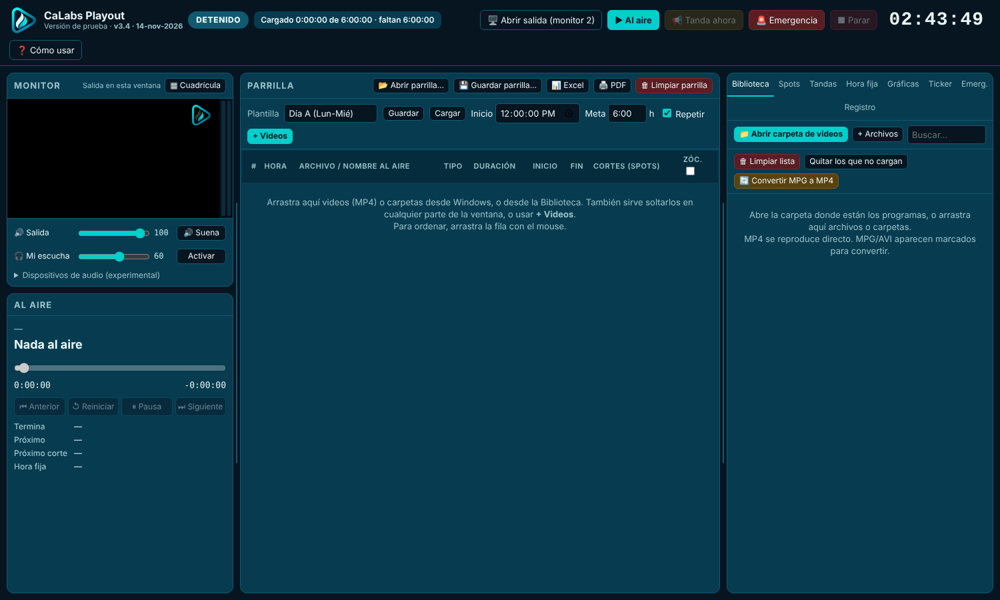

# CaLabs Playout

> 🚧 **Prototipo en desarrollo (v3.4).** Esto es una demo en el navegador, no la versión final.

Sistema de playout para televisión hecho en un solo archivo HTML. Reemplazo moderno para software de emisión antiguo que se congela con programas largos y no maneja bien las tandas.

## Qué hace hoy
- Parrilla con programas, horario ideal y contador de horas cargadas (meta libre).
- Cortes dentro de un programa con grupos de spots guardados.
- Tandas y eventos programados por hora.
- Salida en ventana aparte y salidas extra, con cambio sin cortes entre videos.
- Gráficas en pantalla: mosca (logo), hora, zócalo y ticker, todo editable.
- Vúmetro y control de volumen de salida y de monitoreo.
- Paneles redimensionables y plantillas guardadas.

## Cómo probarlo
1. Descarga el repositorio.
2. Haz doble clic en `Abrir CaLabs Playout.bat` (Windows, usa Chrome o Edge).
   También puedes abrir `CaLabs_Playout.html` directamente en Chrome.
3. Carga tus propios videos en MP4 desde la Biblioteca.
4. ¿Tienes MPG, AVI, WMV…? Usa `Convertir MPG a MP4.bat` (requiere FFmpeg).

## Hoja de ruta
- [ ] Temas de color (Día / Noche / Neutro / Personalizado) e idiomas
- [ ] Vúmetro verde-amarillo-rojo con escala en dB
- [ ] Selección de dispositivos de audio de salida
- [ ] Versión final sobre CasparCG con salida NDI
- [ ] Entradas en vivo (captura HDMI, NDI, ATEM, OBS)
- [ ] Instalador para Windows

## Estado
Proyecto personal en desarrollo. Todos los derechos reservados © CaLabs.
