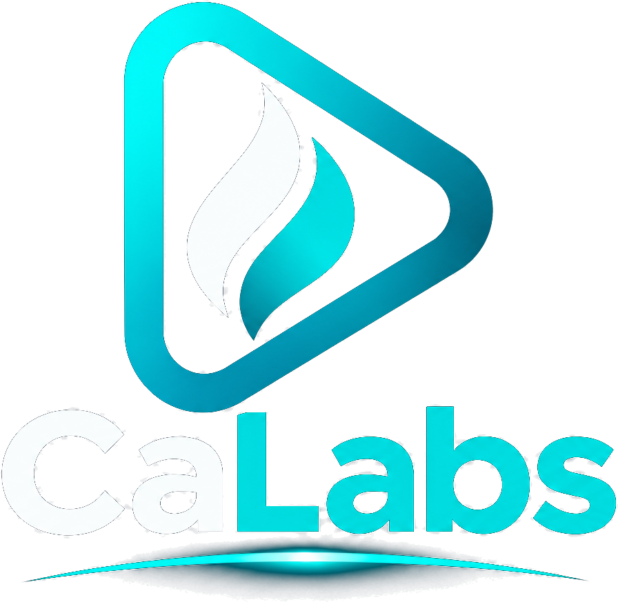
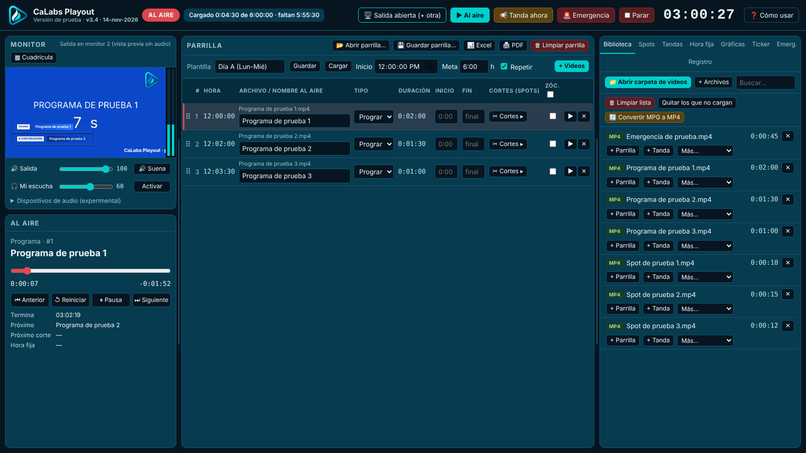
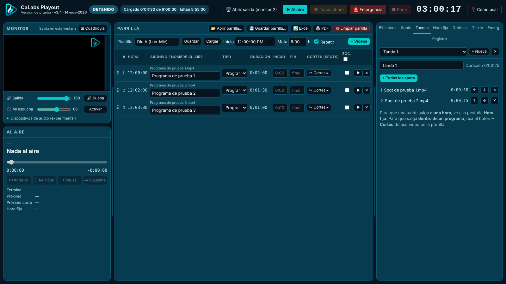
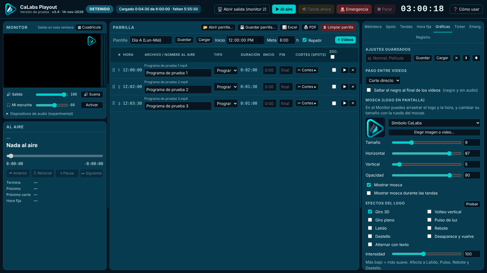

# 📺 CaLabs Playout

**A modern TV playout system that runs in your browser.**
*Un sistema de playout para televisión que funciona en el navegador.*

🚧 `Prototype v3.4 · work in progress` 🚧

---

## 🇬🇧 English

CaLabs Playout is a **TV playout prototype built as a single HTML file**. A modern alternative to old, expensive and unintuitive broadcast software, ideal for people getting started in TV scheduling and media ingest.

> ⚠️ **Language note:** for now the interface is **in Spanish only**. Multi-language support (English included) is **planned and being worked on**. 🌍

### ✨ What it does today
- 🗓️ Schedule grid with a running counter of loaded hours and a free target length
- ✂️ Ad breaks *inside* a program, using saved spot groups
- 📢 Break blocks and fixed-time events
- 🖥️ Separate output window (and extra outputs) with seamless switching between videos
- 🎨 On-screen graphics: logo bug with effects, clock, lower third and ticker
- 🔊 Level meter plus separate output and monitoring volume
- 🧩 Resizable panels and saved templates

### 🚀 Try it
1. Download or clone this repository.
2. Double-click `Abrir CaLabs Playout.bat` (Windows, uses Chrome or Edge), or open `CaLabs_Playout.html` in Chrome.
3. Load your own MP4 videos from the Library tab.
4. Have MPG, AVI or WMV files? Use `Convertir MPG a MP4.bat` (needs FFmpeg).

### 🗺️ Roadmap
- [ ] 🎨 Color themes (Day / Night / Neutral / Custom) and languages
- [ ] 📊 Green-yellow-red level meter with dB scale
- [ ] 🎧 Audio output device selection
- [ ] 🔌 Final version on CasparCG with NDI output
- [ ] 📹 Live inputs (HDMI capture, NDI, ATEM, OBS)
- [ ] 💿 Windows installer

---

## 🇨🇱 Español

CaLabs Playout es un **prototipo de playout para televisión en un solo archivo HTML**. Una alternativa moderna a software de emisión antiguo, caro y poco intuitivo, ideal para personas que están entrando al mundo audiovisual en la programación e ingesta de material para TV.

> ⚠️ **Nota de idioma:** por ahora la interfaz está **solo en español**. El soporte de varios idiomas (incluido inglés) **está planificado y en desarrollo**. 🌍

### ✨ Qué hace hoy
- 🗓️ Parrilla con contador de horas cargadas y duración meta libre
- ✂️ Cortes *dentro* de un programa, con grupos de spots guardados
- 📢 Tandas y eventos a hora fija
- 🖥️ Ventana de salida aparte (y salidas extra), con cambio sin cortes entre videos
- 🎨 Gráficas en pantalla: mosca (logo) con efectos, hora, zócalo y ticker
- 🔊 Vúmetro y volumen separado de salida y de monitoreo
- 🧩 Paneles redimensionables y plantillas guardadas

| Tandas | Gráficas | Ticker |
|:--:|:--:|:--:|
|  |  |  |

### 🚀 Cómo probarlo
1. Descarga o clona este repositorio.
2. Haz doble clic en `Abrir CaLabs Playout.bat` (Windows, usa Chrome o Edge), o abre `CaLabs_Playout.html` en Chrome.
3. Carga tus propios videos MP4 desde la pestaña Biblioteca.
4. ¿Tienes MPG, AVI o WMV? Usa `Convertir MPG a MP4.bat` (requiere FFmpeg).

### 🗺️ Hoja de ruta
- [ ] 🎨 Temas de color (Día / Noche / Neutro / Personalizado) e idiomas
- [ ] 📊 Vúmetro verde-amarillo-rojo con escala en dB
- [ ] 🎧 Selección de dispositivos de audio de salida
- [ ] 🔌 Versión final sobre CasparCG con salida NDI
- [ ] 📹 Entradas en vivo (captura HDMI, NDI, ATEM, OBS)
- [ ] 💿 Instalador para Windows

---

Made with 💙 by **CaLabs** · All rights reserved © CaLabs · *Todos los derechos reservados*

